# แผนพัฒนาระบบจัดซื้อจัดจ้าง โรงเรียนชุมชนวัดไทยงาม

ร่างแผน ณ 12 ตุลาคม 2569

## 1. ภาพรวมและขอบเขต

ระบบนี้เป็น **ระบบงานพัสดุภายในโรงเรียน** สำหรับบันทึก ติดตาม และออกเอกสารการจัดซื้อจัดจ้างตั้งแต่ครูขอซื้อจนตรวจรับ เบิกจ่าย และลงทะเบียนครุภัณฑ์ โดย **ไม่ได้แทนระบบ e-GP ของกรมบัญชีกลาง** แต่เก็บเลขโครงการ e-GP คู่กันเพื่อให้ตรวจสอบย้อนกลับได้

เป้าหมายหลัก:

- ลดเวลาจัดทำเอกสารพัสดุซ้ำ ๆ (รายงานขอซื้อ คำสั่งแต่งตั้ง ใบสั่งซื้อ ใบตรวจรับ) ให้กรอกครั้งเดียวแล้วพิมพ์ได้ทุกฉบับ
- รู้สถานะทุกเรื่องแบบเรียลไทม์ และรู้งบคงเหลือตามแหล่งเงิน/โครงการ
- มีหลักฐานครบสำหรับการตรวจสอบของ สตง. หน่วยตรวจสอบภายใน สพป. และการประเมิน ITA
- ออกรายงานรายเดือน รายไตรมาส รายปี และรายรายการได้ทันที

นอกขอบเขตรุ่นแรก: การยื่นข้อมูลเข้า e-GP อัตโนมัติ (เจ้าหน้าที่ยังบันทึกในเว็บ e-GP เอง ระบบนี้เก็บเลขโครงการและเอกสารที่พิมพ์ออกจาก e-GP) ระบบบัญชีการเงินเต็มรูปแบบ และระบบเงินเดือน

## 2. ระเบียบพัสดุที่ระบบต้องรองรับ

ระบบต้องอิง พ.ร.บ.การจัดซื้อจัดจ้างและการบริหารพัสดุภาครัฐ พ.ศ. 2560 และระเบียบกระทรวงการคลังฯ พ.ศ. 2560 โดย **เกณฑ์วงเงินทุกตัวต้องเก็บเป็นค่าตั้งค่าในระบบ ไม่ฝังในโค้ด** เพราะกรมบัญชีกลางออกหนังสือเวียนปรับเกณฑ์บ่อย

| เกณฑ์ | สิ่งที่ระบบทำ | ที่มา |
| --- | --- | --- |
| วิธีเฉพาะเจาะจง วงเงินครั้งหนึ่งไม่เกิน 500,000 บาท | เสนอวิธีจัดหาอัตโนมัติจากวงเงิน และใส่ข้ออ้างอิงกฎหมายในรายงานขอซื้อ | มาตรา 56 (2)(ข) และกฎกระทรวงกำหนดวงเงินฯ 2560 ([ตัวอย่างแบบฟอร์ม](https://docs.google.com/document/d/1ZwpPC9yzhAVVwWWTAA5DITH_SOAQexf4/export?format=pdf)) |
| วงเงินไม่เกิน 100,000 บาท แต่งตั้งผู้ตรวจรับคนเดียวได้ | เลือกได้ว่าจะตั้ง "ผู้ตรวจรับ" 1 คน หรือ "คณะกรรมการตรวจรับ" | กฎกระทรวงกำหนดวงเงินฯ 2560 ข้อ 5 ([STOU](https://oes.stou.ac.th/sec/wp-content/uploads/sites/8/2020/11/PowerPoint-จัดซื้อจัดจ้าง2.pdf)) |
| วงเงินไม่เกิน 50,000 บาทต่อครั้ง: รายงานขอซื้อเหลือ 3 รายการ ผู้จัดซื้อตรวจรับเองได้ รายงานผลต่อหัวหน้าหน่วยงานภายใน 5 วันทำการ ประกาศผลใน e-GP รายไตรมาส | มีแบบฟอร์ม "รายงานขอซื้อแบบย่อ" และรายงานประกาศผลรายไตรมาส | หนังสือ กค (กวจ) 0405.2/ว 804 ลว. 12 พ.ย. 2568 มีผล 1 ธ.ค. 2568 ([สรุปโยธาไทย](https://www.yotathai.com/passadu/24-11-68-1)) |
| ตั้งแต่ 1 ต.ค. 2569 วิธีคัดเลือกและวิธีเฉพาะเจาะจงต้องทำขั้นเชิญชวน ยื่นข้อเสนอ และพิจารณาผลผ่าน e-GP เท่านั้น | ช่องบังคับกรอกเลขโครงการ e-GP และแนบเอกสารจาก e-GP ก่อนเปลี่ยนสถานะ | หนังสือ กค (กวจ) 0405.4/ว 714 และ 0405.3/ว 715 ลว. 16 ก.ย. 2569 ([กรุงเทพธุรกิจ](https://www.bangkokbiznews.com/economics/1252544)) |
| วิธี e-market / e-bidding สำหรับวงเงินเกิน 500,000 บาท | บันทึกผลและแนบเอกสาร แต่ขั้นตอนหลักทำใน e-GP | ระเบียบฯ 2560 ([สรุป](https://epo16.pcd.go.th/files/com_km/2018-05/20180524_mswezqvv.pdf)) |

ขั้นตอนมาตรฐานที่ระบบต้องมีเอกสารรองรับ: แผนการจัดซื้อจัดจ้างประจำปี → บันทึกขอซื้อ/ขอจ้าง → รายงานขอซื้อขอจ้าง (ข้อ 22) → คำสั่งแต่งตั้งผู้กำหนดรายละเอียด/ผู้ตรวจรับ → ใบเสนอราคา → รายงานผลการพิจารณา → ประกาศผู้ชนะ → ใบสั่งซื้อ/สั่งจ้างหรือสัญญา → ใบตรวจรับ → เบิกจ่าย → ลงทะเบียนคุมพัสดุ

**ข้อควรยืนยันกับ สพป. ก่อนพัฒนา:** ว 804 ยกเว้นการยื่นข้อเสนอผ่าน e-GP สำหรับวงเงินไม่เกิน 50,000 บาทหรือไม่ เมื่อเทียบกับ ว 714 ที่เพิ่งมีผล ผมยังไม่เห็นตัวหนังสือฉบับเต็มจึงไม่สรุปเอง

## 3. บทบาทผู้ใช้และสิทธิ์

คุณเก๋กำหนดไว้ 3 บทบาท ผมแนะนำให้เพิ่ม **ผู้อำนวยการ** (ผู้อนุมัติตามระเบียบ ต้องแยกจากผู้จัดทำ) และ **การเงิน** (เบิกจ่าย) เป็นบทบาทเสริม เพราะระเบียบกำหนดให้หัวหน้าหน่วยงานเป็นผู้เห็นชอบรายงานขอซื้อและสั่งการ ถ้าไม่มีบทบาทนี้ระบบจะไม่มีหลักฐานการอนุมัติ ผู้ใช้หนึ่งคนถือได้หลายบทบาท (เช่น ครูที่เป็นเจ้าหน้าที่พัสดุด้วย)

| ความสามารถ | Admin | เจ้าหน้าที่พัสดุ | ครู | ผู้อำนวยการ (แนะนำ) | การเงิน (แนะนำ) |
| --- | --- | --- | --- | --- | --- |
| จัดการผู้ใช้ บทบาท ข้อมูลโรงเรียน ค่าเกณฑ์วงเงิน | ทำได้ | - | - | ดูได้ | - |
| สร้างบันทึกขอซื้อ/ขอจ้าง | ทำได้ | ทำได้ | ทำได้ (ของตนเอง) | - | - |
| จัดทำรายงานขอซื้อ คำสั่ง ใบสั่งซื้อ ใบตรวจรับ | ทำได้ | ทำได้ | - | - | - |
| อนุมัติ/เห็นชอบรายงานและคำสั่ง | - | - | - | ทำได้ | - |
| บันทึกตรวจรับ (เมื่อถูกแต่งตั้ง) | - | ทำได้ | ทำได้ | - | - |
| บันทึกเบิกจ่าย | ทำได้ | - | - | ดูได้ | ทำได้ |
| จัดการทะเบียนผู้ขาย ทะเบียนครุภัณฑ์ วัสดุคงคลัง | ทำได้ | ทำได้ | ดูได้ | ดูได้ | ดูได้ |
| ดูรายงานทั้งโรงเรียน | ทำได้ | ทำได้ | เฉพาะของตนเอง | ทำได้ | ทำได้ |
| ดูบันทึกการใช้งาน (Audit log) | ทำได้ | - | - | ทำได้ | - |

หลักการสำคัญ: คนที่สร้างเรื่องต้องอนุมัติเรื่องเดียวกันไม่ได้ และคนที่เป็นผู้ขาย/ผู้เสนอราคาต้องไม่ถูกแต่งตั้งเป็นผู้ตรวจรับในเรื่องนั้น ระบบควรเตือนเมื่อชื่อซ้ำกัน

## 4. โมดูลและเมนูแดชบอร์ด

แดชบอร์ดแบ่งเป็น 6 กลุ่มเมนู 22 หน้า ดูหน้าตาได้จากไฟล์ตัวอย่าง `procurement-dashboard-mockup.html`

1. **ภาพรวม**
    - แดชบอร์ด: การ์ดสรุป (งบทั้งปี ใช้ไป คงเหลือ เรื่องรออนุมัติ เรื่องรอตรวจรับ) กราฟใช้จ่ายรายเดือน งบตามแหล่งเงิน เรื่องล่าสุด และการแจ้งเตือนกำหนดส่งของ
    - งานของฉัน: เรื่องที่รอฉันดำเนินการตามบทบาท
2. **งานจัดซื้อจัดจ้าง**
    - แผนจัดซื้อจัดจ้างประจำปี
    - บันทึกขอซื้อ/ขอจ้าง (ครูสร้างได้)
    - ทะเบียนเรื่องจัดซื้อจัดจ้าง: รายการทั้งหมด กรองตามสถานะ วิธี แหล่งเงิน ปีงบประมาณ
    - รายละเอียดเรื่อง: แท็บข้อมูล รายการพัสดุ ผู้เสนอราคา กรรมการ เอกสารแนบ ประวัติสถานะ
    - ตรวจรับพัสดุ
    - สัญญาและหลักประกัน (ใช้กับงานจ้างที่มีสัญญา)
3. **งบประมาณ**
    - แหล่งเงินและโครงการ: เงินอุดหนุนรายหัว เรียนฟรี 15 ปี (แยกรายการย่อย) งบลงทุน เงินรายได้สถานศึกษา
    - การกันเงิน/ผูกพันงบ และงบคงเหลือ
4. **ทะเบียน**
    - ทะเบียนผู้ขาย/ผู้รับจ้าง (เลขผู้เสียภาษี บัญชีธนาคาร สถานะ VAT)
    - ทะเบียนครุภัณฑ์ (เลขครุภัณฑ์ ที่ตั้ง ผู้รับผิดชอบ ค่าเสื่อมราคา)
    - วัสดุคงคลังและใบเบิกวัสดุ
    - ตรวจสอบพัสดุประจำปีและการจำหน่ายพัสดุ
5. **รายงาน**
    - รายงานสรุปผลการจัดซื้อจัดจ้างรายเดือน (แบบ สขร.1) รายไตรมาส รายปี
    - รายงานรายเรื่อง (พิมพ์ชุดเอกสารครบ)
    - รายงานตามแหล่งเงิน ผู้ขาย วิธี และหมวดพัสดุ
6. **ตั้งค่า (Admin)**
    - ผู้ใช้และบทบาท
    - ข้อมูลโรงเรียน ผู้ลงนาม และตราโรงเรียน
    - เกณฑ์วงเงินและข้ออ้างอิงระเบียบ
    - แม่แบบเอกสาร และเลขที่เอกสารอัตโนมัติ
    - บันทึกการใช้งาน (Audit log) และสำรองข้อมูล

## 5. ขั้นตอนและสถานะของเรื่อง

ทุกเรื่องต้องผ่านการเห็นชอบของ ผอ. และการตรวจรับก่อนเบิกจ่าย (9 ขั้น 2 จุดตัดสินใจ)

```mermaid
flowchart LR
    A[บันทึกขอซื้อ/ขอจ้าง<br/>ครู หรือ พัสดุ] --> B[รายงานขอซื้อ + คำสั่ง<br/>เจ้าหน้าที่พัสดุ]
    B --> C{ผอ. เห็นชอบ?}
    C -- ไม่เห็นชอบ: ส่งกลับแก้ไข --> B
    C -- เห็นชอบ --> D[จัดหาตามวิธี<br/>ใบเสนอราคา ผ่าน e-GP]
    D --> E[รายงานผล + ประกาศ<br/>ผู้ชนะการเสนอราคา]
    E --> F[ใบสั่งซื้อ / สัญญา<br/>ผอ. ลงนาม]
    F --> G[ผู้ขายส่งของ<br/>ตามกำหนดส่ง]
    G --> H{ตรวจรับผ่าน?}
    H -- ไม่ผ่าน: แจ้งผู้ขายแก้ไข --> G
    H -- ผ่าน --> I[เบิกจ่ายเงิน<br/>การเงิน]
    I --> J[ลงทะเบียนพัสดุ<br/>ครุภัณฑ์ หรือ วัสดุ]
    J --> K[ปิดเรื่อง<br/>เข้ารายงาน สขร.1]
```



แต่ละกล่องคือหนึ่งสถานะในระบบ ระบบจะไม่ยอมให้ข้ามขั้น และทุกการเปลี่ยนสถานะถูกบันทึกในประวัติ (ใคร เมื่อไร หมายเหตุ) เรื่องยกเลิกได้ทุกขั้นแต่ต้องระบุเหตุผล ส่วนเรื่องวงเงินไม่เกิน 50,000 บาทตาม ว 804 จะรวบขั้นรายงานผลและให้ผู้จัดซื้อตรวจรับเองได้

## 6. รายงานและเอกสารที่ระบบออกได้

เอกสารทุกฉบับดึงข้อมูลจากเรื่องเดียวกัน กรอกครั้งเดียว พิมพ์เป็น PDF ฟอนต์ TH Sarabun New ขนาดกระดาษ A4 ตามรูปแบบหนังสือราชการ และแนบไฟล์สแกนที่ลงนามแล้วกลับเข้าระบบได้

**เอกสารรายเรื่อง (ข้อ 4 ของความต้องการ)**

| เอกสาร | ใช้เมื่อ | ผู้จัดทำ |
| --- | --- | --- |
| บันทึกข้อความขอซื้อ/ขอจ้าง | เริ่มเรื่อง | ครู / พัสดุ |
| รายงานขอซื้อขอจ้าง (แบบเต็ม / แบบย่อ ≤ 50,000) | ก่อนจัดหา | พัสดุ |
| คำสั่งแต่งตั้งผู้กำหนดรายละเอียด และผู้ตรวจรับ/คณะกรรมการตรวจรับ | พร้อมรายงานขอซื้อ | พัสดุ |
| ใบเสนอราคา (แนบจากผู้ขาย) | ระหว่างจัดหา | แนบไฟล์ |
| รายงานผลการพิจารณาและขออนุมัติสั่งซื้อ | หลังได้ราคา | พัสดุ |
| ประกาศผู้ชนะการเสนอราคา | หลังอนุมัติ | พัสดุ |
| ใบสั่งซื้อ/ใบสั่งจ้าง หรือสัญญา | ก่อนส่งของ | พัสดุ |
| ใบตรวจรับพัสดุ | ส่งของแล้ว | ผู้ตรวจรับ |
| บันทึกขออนุมัติเบิกจ่ายเงิน | หลังตรวจรับ | พัสดุ / การเงิน |
| ใบแจ้งหนี้ ใบกำกับภาษี ใบเสร็จ (แนบ) | เบิกจ่าย | แนบไฟล์ |

**รายงานสรุป (ข้อ 5 ของความต้องการ)**

- สรุปผลการจัดซื้อจัดจ้างรายเดือน (แบบ สขร.1) สำหรับเผยแพร่และใช้ประกอบ ITA
- รายงานประกาศผลรายไตรมาส สำหรับเรื่องวงเงินไม่เกิน 50,000 บาทตาม ว 804
- ทะเบียนคุมการจัดซื้อจัดจ้าง กรองตามช่วงวันที่ วิธี แหล่งเงิน ผู้ขาย สถานะ
- รายงานการใช้งบตามแหล่งเงินและโครงการ เทียบแผน/ผล
- รายงานผลการตรวจสอบพัสดุประจำปี และทะเบียนครุภัณฑ์พร้อมค่าเสื่อมราคา
- ส่งออกทุกรายงานเป็น PDF และ Excel

รูปแบบฟอร์มแต่ละฉบับควรใช้ต้นแบบที่โรงเรียนหรือ สพป. ใช้อยู่จริง เพื่อให้ผู้ตรวจสอบคุ้นเคย

## 7. สถาปัตยกรรมเทคนิค

ผมแนะนำ **Next.js (React + TypeScript) + PostgreSQL + Prisma บน Vercel** เพราะได้ทั้งหน้าเว็บ React และ API ฝั่ง Node.js ในโปรเจกต์เดียว deploy บน Vercel ได้ตรงที่สุด ถ้าคุณเก๋อยากแยก React (Vite) กับ Node (Express) เป็นสองส่วนก็ทำได้ แต่ต้องตั้งค่า deploy เพิ่ม

| ส่วน | ตัวเลือกที่แนะนำ | เหตุผล |
| --- | --- | --- |
| Frontend + API | Next.js App Router, TypeScript, Server Actions / Route Handlers | React + Node ในที่เดียว รองรับ Vercel โดยตรง |
| UI | Tailwind CSS + shadcn/ui, TanStack Table, Recharts | ตารางกรอง/เรียงข้อมูลเยอะ และกราฟแดชบอร์ด |
| ฟอร์ม/ตรวจข้อมูล | react-hook-form + zod | ใช้ schema เดียวกันทั้งฝั่งหน้าเว็บและ API |
| ฐานข้อมูล | PostgreSQL (เช่น Neon หรือ Supabase) | มีให้เชื่อมผ่าน Vercel Marketplace, รองรับ enum/JSON/transaction ดี |
| ORM | Prisma + Prisma Migrate | ตามที่คุณเก๋เลือก |
| เข้าสู่ระบบ | Auth.js (อีเมล/รหัสผ่าน และเลือกเปิด Google ได้) | ผูกสิทธิ์ตามบทบาทในฐานข้อมูล |
| เก็บไฟล์แนบ | Vercel Blob (แบบ private) หรือ Cloudflare R2 / S3 | Vercel Functions ไม่มีดิสก์ถาวร ต้องเก็บไฟล์นอกเซิร์ฟเวอร์ และให้เบราว์เซอร์อัปโหลดตรงเพื่อเลี่ยงขีดจำกัดขนาด request |
| ออกเอกสาร PDF | แม่แบบ HTML ขนาด A4 + CSS พิมพ์ ใช้ฟอนต์ TH Sarabun New / Sarabun | ภาษาไทยตัดคำและวางสระถูกต้องที่สุด พิมพ์หรือบันทึกเป็น PDF ได้ทันที |
| ส่งออก Excel | exceljs | รายงานรายเดือน/รายปี |

เรื่องเฉพาะของงานราชการที่ต้องทำในโค้ด:

- ปีงบประมาณ 1 ต.ค. – 30 ก.ย. แสดงวันที่เป็น พ.ศ. และเวลา Asia/Bangkok
- แปลงจำนวนเงินเป็นตัวอักษรไทย ("หนึ่งหมื่นบาทถ้วน") และคำนวณ VAT 7% แบบรวม/ไม่รวม
- เลขที่เอกสารรันอัตโนมัติแยกตามประเภทและปีงบประมาณ ต้องกันเลขซ้ำด้วย transaction ของฐานข้อมูล
- เก็บเงินเป็นชนิด Decimal ไม่ใช้ float

MySQL ใช้ได้เช่นกันและ Prisma รองรับเท่ากัน ผมเอนไปทาง PostgreSQL เพราะตัวเลือกโฮสต์ที่เชื่อมกับ Vercel ได้ตรงมีมากกว่า ส่วนราคาแพ็กเกจของแต่ละเจ้าควรเช็กอีกครั้งก่อนเลือก

## 8. โครงสร้างฐานข้อมูล (Prisma)

ตารางหลักมี 22 ตาราง (14 กลุ่ม) แกนกลางคือ `Procurement` (หนึ่งเรื่องจัดซื้อจัดจ้าง) ที่ผูกกับรายการพัสดุ ผู้ขาย กรรมการ เอกสารแนบ และประวัติสถานะ นี่เป็นร่างแรกสำหรับคุยกัน ยังไม่ใช่ schema สุดท้าย

| ตาราง | เก็บอะไร |
| --- | --- |
| User, Role, UserRole | ผู้ใช้ บทบาท (หนึ่งคนหลายบทบาท) |
| FiscalYear | ปีงบประมาณ และสถานะเปิด/ปิดปี |
| FundSource, Project | แหล่งเงิน (รายหัว เรียนฟรี 15 ปี ฯลฯ) และโครงการตามแผนปฏิบัติการ พร้อมวงเงิน |
| ProcurementPlan | แผนจัดซื้อจัดจ้างประจำปี |
| Procurement | เรื่องจัดซื้อ/จ้าง: เลขที่ ประเภท วิธี วงเงิน ราคากลาง ราคาที่ตกลง สถานะ เลขโครงการ e-GP |
| ProcurementItem | รายการพัสดุ จำนวน หน่วย ราคาต่อหน่วย |
| Vendor, Quotation | ทะเบียนผู้ขาย และใบเสนอราคาแต่ละราย |
| CommitteeMember | ผู้กำหนดรายละเอียด ผู้ตรวจรับ/คณะกรรมการ ต่อเรื่อง |
| Inspection, Payment | การตรวจรับ และการเบิกจ่าย |
| Attachment | ไฟล์แนบ: ประเภทเอกสาร URL ใน Blob ผู้อัปโหลด |
| Asset, StockItem, StockMovement | ครุภัณฑ์ วัสดุคงคลัง การรับ-เบิก |
| StatusHistory, AuditLog | ประวัติสถานะ และบันทึกการแก้ไขทุกครั้ง |
| Setting, DocumentSequence | เกณฑ์วงเงิน ผู้ลงนาม และตัวนับเลขที่เอกสาร |

```prisma
enum ProcurementType { PURCHASE  HIRE  RENT }
enum ProcurementMethod { SPECIFIC  SELECTIVE  E_MARKET  E_BIDDING }
enum ProcurementStatus {
  DRAFT  REQUESTED  REPORT_PREPARED  APPROVED  QUOTING
  AWARDED  ORDERED  DELIVERED  INSPECTED  PAID  CLOSED  CANCELLED
}

model Procurement {
  id             String   @id @default(cuid())
  docNo          String   @unique          // เช่น พด.12/2570
  fiscalYear     Int
  title          String
  type           ProcurementType
  method         ProcurementMethod
  reason         String
  budgetAmount   Decimal  @db.Decimal(14, 2) // วงเงินงบประมาณ
  referencePrice Decimal? @db.Decimal(14, 2) // ราคากลาง
  agreedAmount   Decimal? @db.Decimal(14, 2)
  egpProjectNo   String?                    // เลขโครงการ e-GP
  status         ProcurementStatus @default(DRAFT)
  dueDate        DateTime?
  requesterId    String
  projectId      String
  vendorId       String?
  items          ProcurementItem[]
  quotations     Quotation[]
  committee      CommitteeMember[]
  attachments    Attachment[]
  history        StatusHistory[]
  createdAt      DateTime @default(now())
  updatedAt      DateTime @updatedAt
}
```

## 9. ฟีเจอร์ที่ควรมีเพิ่ม (ข้อ 6 ของความต้องการ)

สิ่งที่ผมตรวจแล้วเห็นว่าควรเพิ่ม เรียงตามความสำคัญ:

| ฟีเจอร์ | ทำไมควรมี | เฟส |
| --- | --- | --- |
| ตรวจการแบ่งซื้อแบ่งจ้าง | เตือนเมื่อซื้อพัสดุประเภทเดียวกันหลายครั้งในช่วงใกล้กันจนรวมแล้วเกินเกณฑ์วิธี เป็นจุดที่ถูกตรวจพบบ่อย | 1 |
| ตรวจงบคงเหลือก่อนอนุมัติ | ไม่ให้อนุมัติเกินวงเงินของแหล่งเงิน/โครงการ | 1 |
| Checklist เอกสารตามวิธีจัดหา | เปลี่ยนสถานะไม่ได้ถ้าเอกสารบังคับยังไม่แนบ | 1 |
| บันทึกการใช้งาน (Audit log) | รู้ว่าใครแก้อะไร เมื่อไร ใช้ตอบผู้ตรวจสอบ | 1 |
| แจ้งเตือนกำหนดส่งของ/ครบกำหนดตรวจรับ | กันงานค้างและค่าปรับที่ไม่ได้คิด | 2 |
| คำนวณค่าปรับส่งของล่าช้า | ตามอัตราที่ระบุในใบสั่ง/สัญญา | 2 |
| ทะเบียนครุภัณฑ์ + QR Code ติดครุภัณฑ์ | ตรวจนับประจำปีด้วยมือถือ | 2 |
| วัสดุคงคลังและใบเบิก | ครูเบิกวัสดุ ระบบตัดสต็อก | 2 |
| ประวัติราคาจากการซื้อครั้งก่อน | ช่วยกำหนดราคากลาง/ราคาตลาด | 2 |
| แจ้งเตือนผ่านอีเมลหรือ LINE | ผู้อำนวยการอนุมัติได้เร็วขึ้น | 3 |
| ปิดปีงบประมาณ / ยกยอด | ล็อกข้อมูลปีเก่าไม่ให้แก้ | 3 |

**ความปลอดภัยและ PDPA**

- เก็บรหัสผ่านแบบ hash ตรวจสิทธิ์ทุก API ฝั่งเซิร์ฟเวอร์ ไม่พึ่งการซ่อนเมนูอย่างเดียว
- ไฟล์แนบเป็น private เปิดผ่านลิงก์ที่หมดอายุ เพราะมีเลขบัตรประชาชน เลขบัญชีธนาคารของผู้ขาย
- ไม่ลบข้อมูลจริง ใช้การยกเลิกพร้อมเหตุผล (soft delete) เพื่อคงหลักฐาน
- สำรองฐานข้อมูลอัตโนมัติรายวัน และทดสอบกู้คืนอย่างน้อยภาคเรียนละครั้ง
- มีประกาศความเป็นส่วนตัวสั้น ๆ สำหรับข้อมูลผู้ขายและบุคลากร

## 10. แผนงานและระยะเวลา

ใช้งานจริงได้ใน 4 ระยะ ประมาณ 15–20 สัปดาห์ (ประมาณการสำหรับผู้พัฒนา 1 คน ปรับได้หลังตอบคำถามข้อ 11)

| ระยะ | ระยะเวลาโดยประมาณ | งานหลัก | เกณฑ์ผ่าน |
| --- | --- | --- | --- |
| 0 เตรียมงาน | 2 สัปดาห์ | ยืนยันคำถามข้อ 11 · รวบรวมแบบฟอร์มเดิม · ออกแบบฐานข้อมูล · ตั้งโปรเจกต์ + Vercel | อนุมัติแบบหน้าจอ |
| **1 ระบบหลัก (MVP)** | 6–8 สัปดาห์ | ล็อกอิน + สิทธิ์ตามบทบาท · แหล่งเงิน ผู้ขาย · ขอซื้อ → ตรวจรับ · แนบไฟล์ + พิมพ์เอกสาร · แดชบอร์ดพื้นฐาน | ทดลองกับเรื่องจริง |
| 2 รายงานและทะเบียน | 4–6 สัปดาห์ | สขร.1 + ส่งออก Excel · ครุภัณฑ์ + QR Code · วัสดุคงคลัง · แจ้งเตือน + ค่าปรับ | ออกรายงานได้ครบ |
| 3 ส่งมอบ | 3–4 สัปดาห์ | แจ้งเตือน LINE / อีเมล · ปิดปีงบประมาณ · นำเข้าข้อมูลเก่า · อบรมครูและพัสดุ | ใช้ทั้งโรงเรียน |

ระยะที่ 1 คือหัวใจของระบบ หลังจบระยะนี้เจ้าหน้าที่พัสดุเริ่มใช้งานจริงได้ ตัวเลขสัปดาห์เป็นการประมาณคร่าว ๆ สำหรับผู้พัฒนาคนเดียวทำงานเต็มเวลา จะปรับให้แม่นขึ้นหลังคุณเก๋ตอบคำถามในข้อ 11

## 11. คำถามที่ต้องให้คุณเก๋ยืนยันก่อนเริ่ม

- [ ] ใช้ Next.js (React + Node ในโปรเจกต์เดียว) ได้ไหม หรืออยากแยก React (Vite) กับ Node (Express)
- [ ] เลือก PostgreSQL ตามที่แนะนำ หรือ MySQL
- [ ] ผู้อนุมัติคือผู้อำนวยการคนเดียว หรือมีรองผู้อำนวยการ/หัวหน้าเจ้าหน้าที่พัสดุที่ลงนามแทนด้วย
- [ ] ต้องมีบทบาทการเงินแยกไหม หรือเจ้าหน้าที่พัสดุบันทึกเบิกจ่ายเอง
- [ ] โรงเรียนมีแบบฟอร์มเอกสารพัสดุที่ใช้อยู่ (Word/PDF) ส่งให้ได้ไหม จะได้ทำแม่แบบให้ตรง
- [ ] แหล่งเงินที่โรงเรียนใช้จริงมีอะไรบ้าง และงานอาหารกลางวันโรงเรียนจัดซื้อเองหรือไม่
- [ ] รูปแบบเลขที่เอกสารที่ใช้อยู่ (เช่น ที่ ศธ ... / เลขคำสั่ง / เลขใบสั่งซื้อ)
- [ ] จำนวนผู้ใช้โดยประมาณ และงบค่าโฮสต์ต่อเดือนที่รับได้
- [ ] ต้องนำข้อมูลปีงบประมาณก่อน ๆ เข้าระบบด้วยไหม
- [ ] ยืนยันกับ สพป. ว่าเรื่องวงเงินไม่เกิน 50,000 บาท (ว 804) ต้องยื่นข้อเสนอผ่าน e-GP ตาม ว 714 ด้วยหรือไม่

## แหล่งอ้างอิง

- [กรุงเทพธุรกิจ: กรมบัญชีกลางกำหนดให้วิธีคัดเลือกและเฉพาะเจาะจงผ่าน e-GP เริ่ม 1 ต.ค. 2569 (ว 714, ว 715)](https://www.bangkokbiznews.com/economics/1252544)
- [โยธาไทย: สรุปแนวทาง ว 804 จัดซื้อวงเงินไม่เกิน 50,000 บาท](https://www.yotathai.com/passadu/24-11-68-1)
- [ตัวอย่างรายงานขอซื้อ วิธีเฉพาะเจาะจง ไม่เกิน 500,000 บาท และผู้ตรวจรับกรณีไม่เกิน 100,000 บาท](https://docs.google.com/document/d/1ZwpPC9yzhAVVwWWTAA5DITH_SOAQexf4/export?format=pdf)
- [มสธ.: สรุปการจัดซื้อจัดจ้าง ผู้ตรวจรับวงเงินไม่เกิน 100,000 บาท](https://oes.stou.ac.th/sec/wp-content/uploads/sites/8/2020/11/PowerPoint-จัดซื้อจัดจ้าง2.pdf)
- [สรุปวิธี e-market / e-bidding](https://epo16.pcd.go.th/files/com_km/2018-05/20180524_mswezqvv.pdf)
